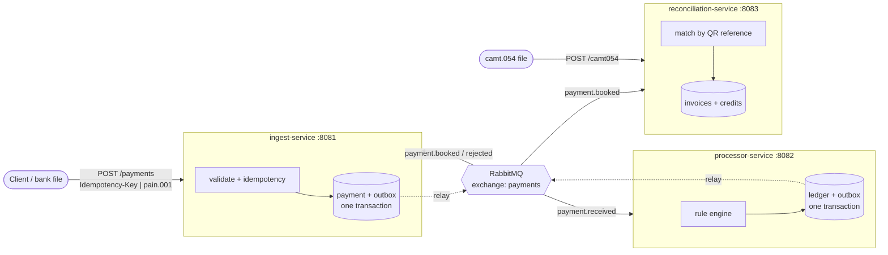

# Swiss payments platform

[](https://github.com/Vaggelisvl/swiss-payments-platform/actions/workflows/ci.yml)

An event-driven payments backend in **Java 21 / Spring Boot 3**: payments are accepted idempotently (JSON or ISO 20022 `pain.001`), validated and booked on a ledger, and the resulting credits are reconciled against QR-bill invoices (matching by QR reference, also from `camt.054` bank files).

It is a portfolio project built to show how I design for **consistency, failure and operations**, not only for the happy path. It complements my [Swiss QR-bill service](https://github.com/Vaggelisvl/swiss-qr-bill-service).

## Architecture



| Service | Responsibility | Own database |
|---|---|---|
| `ingest-service` | Accepts payments, deduplicates by `Idempotency-Key`, parses `pain.001`, publishes `PaymentReceived`, keeps the queryable payment status | `ingest` |
| `processor-service` | Rule engine (limits, deny list, same account), double-entry ledger, publishes `PaymentBooked` / `PaymentRejected` | `processor` |
| `reconciliation-service` | Matches credits (events and `camt.054`) to invoices: paid, partial, overpaid, unmatched, wrong currency | `reconciliation` |

Shared libraries: `payments-domain` (validated value objects: IBAN, QR/creditor reference, money), `payments-contracts` (event records and topology names), `outbox` (transactional outbox store + relay).

## Design decisions

- **Transactional outbox.** State change and event are written in one database transaction; a relay publishes them with publisher confirms. If the broker is down the API still accepts payments and nothing is lost (see the outage demo). Unroutable messages are retried, not dropped. ([ADR 0002](docs/adr/0002-transactional-outbox.md))
- **Idempotency at every hop.** Client retries: unique `Idempotency-Key` with a content fingerprint (same key + different body = `409`). Message redelivery: the processor records each payment id and the reconciliation records each credit entry id. Re-uploading a `camt.054` file changes nothing.
- **No lost updates under concurrency.** The debtor account row is locked (`SELECT ... FOR UPDATE`) while a payment is processed; credits use an atomic `UPDATE balance = balance + ?`. A test fires 40 concurrent payments of 10 CHF at an account holding 100 CHF: exactly 10 are booked, 30 rejected, balance ends at 0. ([ADR 0003](docs/adr/0003-concurrency-control.md))
- **Poison messages do not block the queue.** Bounded retries with backoff, then the dead-letter queue.
- **Make illegal states unrepresentable.** Immutable self-validating records (`Iban`, `Money`, `QrReference`...), a sealed `PaymentReference`, exhaustive `switch`.
- **Hardened XML.** `pain.001` / `camt.054` are parsed with StAX with DTDs and external entities disabled (XXE tests included) and a body size limit.
- **Database per service**, Flyway migrations, no shared tables ([ADR 0001](docs/adr/0001-service-boundaries.md)).
- **Executable architecture.** ArchUnit tests fail the build if a domain package depends on adapters or frameworks ([ADR 0004](docs/adr/0004-layering-and-archunit.md)).
- **Operations.** Problem-details errors (RFC 9457), graceful shutdown, health probes, Micrometer metrics at `/actuator/prometheus` (`payments.received`, `payments.rejected{reason}`, `outbox.published`, `reconciliation.credits{result}`...), `-Xlint:all -Werror`.

## Run it

Requires Java 21 and Maven for the build; Docker for the compose stack.

```bash
docker compose -f deploy/docker-compose.yml up --build   # PostgreSQL, RabbitMQ, 3 services, Prometheus
./scripts/demo.sh                                         # end-to-end walkthrough (needs curl, jq, python3)
./scripts/outage-demo.sh                                  # broker outage: nothing is lost
```

Ports: ingest `8081`, processor `8082`, reconciliation `8083`, RabbitMQ UI `15672` (guest/guest), Prometheus `9090`.

Without Docker, start PostgreSQL (databases `ingest`, `processor`, `reconciliation`, user/password `payments`) and RabbitMQ locally, then `mvn install -DskipTests` and `java -jar services/<name>/target/<name>-1.0.0-SNAPSHOT.jar`.

### Tests
```bash
mvn verify          # unit tests + architecture rules (no infrastructure needed)
mvn verify -Pit     # + integration tests against real PostgreSQL and RabbitMQ
```
The integration tests (`*IT`) cover idempotent intake incl. a race of 8 parallel identical requests, the outbox publishing exactly once, double-entry bookings, every rejection code, redelivery, the concurrency scenario above, the dead-letter queue, `pain.001` and `camt.054` imports. CI runs them with PostgreSQL and RabbitMQ service containers.

## API (short)

| Method & path | Service | Notes |
|---|---|---|
| `POST /api/v1/payments` | ingest | header `Idempotency-Key` required; `202` new, `200` replay, `409` key reused with other body, `422` invalid |
| `POST /api/v1/payments/pain001` | ingest | ISO 20022 `pain.001` XML, one payment per `CdtTrfTxInf` |
| `GET /api/v1/payments/{id}` | ingest | `RECEIVED` / `BOOKED` / `REJECTED` + rejection code |
| `POST /api/v1/accounts`, `GET /api/v1/accounts/{iban}` | processor | demo funding of ledger accounts |
| `POST /api/v1/invoices`, `GET /api/v1/invoices/{id}` | reconciliation | invoice with QRR/SCOR reference |
| `POST /api/v1/camt054` | reconciliation | bank statement import, deduplicated |
| `GET /api/v1/reconciliation/review` | reconciliation | unmatched, wrong-currency and overpaid credits |

A complete recorded run is in [`docs/demo-output.txt`](docs/demo-output.txt) and the outage scenario in [`docs/outage-demo-output.txt`](docs/outage-demo-output.txt). Excerpt:

```text
== 4. Retry with the same key: HTTP 200, same payment, nothing duplicated
Idempotent-Replayed: true
== 7. A payment the debtor cannot afford is rejected with a stable reason code
{"status":"REJECTED","rejectionCode":"INSUFFICIENT_FUNDS", ...}
== 10. The first pain.001 transfer paid the same invoice again: reconciliation flags it for review
{"reference":"2100...9017","amount":1949.75,"result":"OVERPAID"}
```

## Scope and limitations

This is a demonstration, not a bank. Deliberately out of scope: authentication/authorization (the demo account API is open), a real sanctions list, multi-currency conversion, a schema registry, distributed tracing, an HA broker/database topology, and the full ISO 20022 message variety (only the elements needed here are read). The compose file and Dockerfile are written for local use; I verified the services with real PostgreSQL and RabbitMQ processes, but have not run the Docker build in CI yet.

## License
MIT
